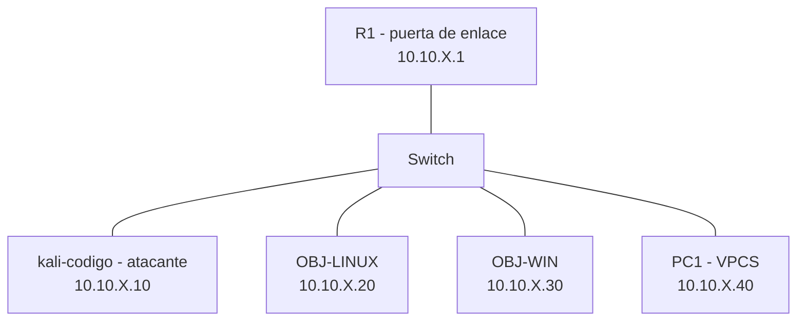

# Taller de Nmap: reconocimiento y análisis de vulnerabilidades en GNS3

Taller individual del curso de Hacking Ético. Cada estudiante recorre, dentro de su propia infraestructura GNS3, el ciclo completo de reconocimiento activo con Nmap: descubrir hosts, enumerar puertos y servicios, identificar vulnerabilidades, generar reportes y proponer mitigaciones.

El taller no se evalúa por ejecutar comandos, sino por interpretar sus resultados. Cada actividad incluye preguntas de análisis que deben responderse en el informe.

> [!WARNING]
> Todos los escaneos se ejecutan únicamente contra los equipos del laboratorio GNS3 del propio estudiante. Escanear redes o equipos sin autorización escrita de su propietario es una falta ética y, en la mayoría de países, un delito. En Colombia aplica la Ley 1273 de 2009.

## Contenido

1. [Resultados de aprendizaje](#1-resultados-de-aprendizaje)
2. [Alcance, ética y reglas del laboratorio](#2-alcance-ética-y-reglas-del-laboratorio)
3. [Preparación del entorno](#3-preparación-del-entorno)
4. [Fase 1: descubrimiento de hosts](#4-fase-1-descubrimiento-de-hosts)
5. [Fase 2: escaneo de puertos](#5-fase-2-escaneo-de-puertos)
6. [Fase 3: enumeración de servicios y sistema operativo](#6-fase-3-enumeración-de-servicios-y-sistema-operativo)
7. [Fase 4: identificación de vulnerabilidades](#7-fase-4-identificación-de-vulnerabilidades)
8. [Fase 5: generación de reportes](#8-fase-5-generación-de-reportes)
9. [Fase 6: análisis, defensa y mitigación](#9-fase-6-análisis-defensa-y-mitigación)
10. [Entregable](#10-entregable)
11. [Rúbrica de evaluación](#11-rúbrica-de-evaluación)
12. [Referencias base](#12-referencias-base)

## 1. Resultados de aprendizaje

Al finalizar, el estudiante podrá:

1. Explicar cómo Nmap determina si un host está activo y si un puerto está abierto, cerrado o filtrado.
2. Seleccionar el tipo de escaneo adecuado según el objetivo, el tiempo disponible y el ruido que genera en la red.
3. Enumerar servicios, versiones y sistema operativo, y valorar la confiabilidad de cada detección.
4. Usar el motor de scripts (NSE) para identificar vulnerabilidades, relacionarlas con CVE y distinguir hallazgos reales de falsos positivos.
5. Generar reportes en los formatos de Nmap y aprovecharlos para automatizar el análisis.
6. Priorizar hallazgos por riesgo y proponer mitigaciones verificables.

**Modalidad:** individual.
**Herramientas:** GNS3, Kali Linux (o equivalente) con Nmap 7.9x, Wireshark.
**Conocimientos previos:** modelo TCP/IP, saludo de tres vías de TCP, direccionamiento IPv4 y manejo básico de la terminal de Linux.

## 2. Alcance, ética y reglas del laboratorio

- La red del laboratorio debe estar aislada de la red de la universidad y de la red doméstica. La única salida permitida a Internet es la que se indica en la actividad 4.3.
- No se escanean direcciones fuera del segmento asignado, aunque respondan.
- Los scripts de la categoría `vuln` pueden bloquear o reiniciar servicios. Por eso solo se ejecutan contra máquinas del laboratorio diseñadas para ser vulnerables.
- El informe incluye, como primera página, una declaración de alcance firmada: segmento escaneado, equipos objetivo, fecha y nombre del estudiante. Es el equivalente académico de las reglas de compromiso de una prueba de penetración real.

### Evidencia individual

Para que cada entrega sea verificable:

- El equipo atacante debe llamarse `kali-<código del estudiante>`, de modo que el código aparezca en el indicador de la terminal en todas las capturas.
- Cada captura debe mostrar el comando completo, su salida y el resultado de `date`.
- El segmento de red se deriva del código del estudiante (ver sección 3), por lo que las direcciones IP de cada informe son distintas.

## 3. Preparación del entorno

La topología mínima tiene un atacante y al menos dos objetivos con sistemas operativos distintos en el segmento `10.10.X.0/24`, donde X son los dos últimos dígitos del código del estudiante.



| Nodo | Rol | Dirección | Imagen sugerida |
| --- | --- | --- | --- |
| R1 | Puerta de enlace | 10.10.X.1 | Router disponible en GNS3 (VyOS, MikroTik CHR o Cisco IOS) |
| `kali-<código>` | Atacante | 10.10.X.10 | Kali Linux |
| OBJ-LINUX | Objetivo 1 | 10.10.X.20 | Metasploitable 2 |
| OBJ-WIN | Objetivo 2 | 10.10.X.30 | Windows vulnerable de laboratorio (por ejemplo Metasploitable 3) |
| PC1 | Host de relleno | 10.10.X.40 | VPCS |

Si el equipo no soporta el objetivo Windows, se reemplaza por un segundo Linux con Samba activo y se indica en el informe.

### Verificación previa (evidencia 0 del informe)

- [ ] Captura de la topología en GNS3 con todos los nodos encendidos.
- [ ] `ip a` en el atacante mostrando la dirección asignada.
- [ ] `ping` exitoso del atacante a cada objetivo.
- [ ] `nmap --version` y `sudo nmap --script-updatedb`.
- [ ] Instantánea (snapshot) de los objetivos antes de iniciar, para poder restaurarlos si un script los deja inestables.

En adelante, `<RED>` es el segmento `10.10.X.0/24` y `<HOST>` es cada uno de los objetivos. Las fases 2 a 5 se ejecutan contra los dos objetivos.

## 4. Fase 1: descubrimiento de hosts

### Actividad 1.1 Barrido de la red

```bash
nmap -sn <RED>
sudo nmap -sn <RED>
```

Ejecutar el comando sin privilegios y luego con `sudo`. Documentar los dispositivos identificados en una tabla con dirección IP, dirección MAC, fabricante y rol dentro de la topología.

### Actividad 1.2 Qué viaja por el cable

Iniciar una captura de Wireshark en el enlace del atacante (clic derecho sobre el enlace en GNS3, *Start capture*) y repetir el barrido con `sudo`. Guardar la captura como `fase1.pcapng`.

### Preguntas de análisis

1. ¿Qué diferencia hay entre la salida con y sin `sudo`? ¿Por qué solo una muestra direcciones MAC?
2. Según la captura, ¿qué protocolo usó Nmap para descubrir hosts en la red local? ¿Qué sondas usaría si los objetivos estuvieran en otra red?
3. Si un host bloquea ICMP, ¿seguiría apareciendo en este barrido? Justificar con la captura.
4. ¿Qué opción permite escanear puertos de un host que no responde al descubrimiento?

## 5. Fase 2: escaneo de puertos

### Actividad 2.1 Escaneo rápido

```bash
nmap -F <HOST>
```

Identificar los puertos abiertos y los servicios asociados. Anotar el tiempo total que reporta Nmap.

### Actividad 2.2 Escaneo completo

```bash
nmap -p- <HOST>
```

Comparar con el escaneo rápido en una tabla de tres columnas: puerto, aparece en `-F`, aparece en `-p-`. Anotar el tiempo total. En el laboratorio se puede añadir `-T4` para acortar la espera.

### Actividad 2.3 Técnicas de escaneo TCP

```bash
sudo nmap -sS -p 22,80,445,9999 <HOST>
nmap -sT -p 22,80,445,9999 <HOST>
```

Capturar ambos escaneos en Wireshark y aplicar el filtro `tcp.port == 80`. Incluir en el informe la secuencia de segmentos de cada técnica para un puerto abierto y para uno cerrado.

### Actividad 2.4 Puertos UDP

```bash
sudo nmap -sU --top-ports 20 <HOST>
```

### Preguntas de análisis

1. ¿Cuántos puertos revisa Nmap por defecto, cuántos con `-F` y cuántos con `-p-`? ¿Con qué criterio elige los de `-F`?
2. ¿Qué servicios aparecieron solo en el escaneo completo? ¿Qué riesgo habría pasado inadvertido usando únicamente `-F`?
3. Según las capturas, ¿en qué se diferencian `-sS` y `-sT`? ¿Cuál deja registro en los logs del servicio y por qué?
4. ¿Qué significan los estados `open`, `closed`, `filtered` y `open|filtered`? Dar un ejemplo real de cada uno tomado de sus resultados; para verlos todos puede añadir `--reason`.
5. ¿Por qué el escaneo UDP es más lento y menos concluyente que el TCP?

## 6. Fase 3: enumeración de servicios y sistema operativo

### Actividad 3.1 Detección de versiones

```bash
nmap -sV <HOST>
```

Registrar en una tabla puerto, protocolo, servicio, producto y versión. Usar como lista de puertos la obtenida en el escaneo completo (`-p <lista>`), no solo los puertos por defecto.

### Actividad 3.2 Identificación del sistema operativo

```bash
sudo nmap -O <HOST>
```

Analizar la precisión de la detección: iniciar sesión en cada objetivo, consultar el sistema real (`uname -a` y `cat /etc/os-release` en Linux, `systeminfo` en Windows) y compararlo con lo que reportó Nmap.

### Actividad 3.3 Scripts por defecto

```bash
nmap -sC -p <puertos abiertos> <HOST>
```

### Preguntas de análisis

1. ¿Cómo obtiene Nmap la versión de un servicio? ¿Qué diferencia hay entre leer el banner y enviar sondas?
2. Elegir un servicio y verificar su versión directamente en el objetivo. ¿Coincide con la detectada?
3. ¿Qué condiciones necesita `-O` para dar un resultado confiable? ¿Se cumplían en sus objetivos?
4. ¿Qué información adicional aportaron los scripts por defecto que no dio `-sV`?
5. ¿Cómo podría un administrador reducir la información que entregan sus servicios a estas técnicas?

## 7. Fase 4: identificación de vulnerabilidades

Antes de empezar, revisar qué se va a ejecutar con `nmap --script-help vuln` e identificar al menos dos scripts marcados también como `intrusive` o `dos`.

### Actividad 4.1 Vulnerabilidades generales

```bash
nmap --script=vuln <HOST>
```

Documentar las vulnerabilidades encontradas, indicando para cada una el script que la reportó y el estado que muestra (`VULNERABLE`, `LIKELY VULNERABLE` o `NOT VULNERABLE`).

### Actividad 4.2 Vulnerabilidades SMB

```bash
nmap --script "smb-vuln*" -p 139,445 <HOST>
```

El patrón va entre comillas para que lo interprete Nmap y no la terminal. Analizar los riesgos identificados: qué permite cada vulnerabilidad a un atacante y qué incidentes conocidos la aprovecharon.

### Actividad 4.3 Vulnerabilidades asociadas a CVE

```bash
nmap -sV --script vulners <HOST>
nmap -sV --script vulners --script-args mincvss=7.0 <HOST>
```

El script `vulners` consulta una base de datos en Internet. Para esta actividad se conecta temporalmente un nodo NAT al atacante, nunca a los objetivos, y se retira al terminar. Relacionar los hallazgos con los CVE reportados y consultar al menos tres de ellos en la base NVD.

### Actividad 4.4 Validación de hallazgos

Elegir tres hallazgos de las actividades anteriores y clasificarlos como confirmado, probable o falso positivo. La validación se hace sin explotar: contrastando la versión real del servicio en el objetivo con las versiones afectadas que indica el CVE.

**Tabla de vulnerabilidades** (entregable): host, puerto, servicio, script que la detectó, CVE, puntaje CVSS, severidad y estado de validación.

### Preguntas de análisis

1. ¿Qué diferencia hay entre un script que prueba activamente una vulnerabilidad y uno que la infiere por la versión? ¿Cuál genera más falsos positivos?
2. ¿Por qué sería riesgoso ejecutar `--script=vuln` contra un servidor en producción, incluso con autorización?
3. ¿Algún hallazgo apareció en `vulners` pero no en `vuln`, o al contrario? ¿A qué se debe?
4. De todos los hallazgos, ¿cuál atendería primero y por qué? Considerar severidad, exposición y facilidad de explotación.

## 8. Fase 5: generación de reportes

### Actividad 5.1 Texto plano

```bash
nmap -sV -oN reporte.txt <HOST>
```

Adjuntar el archivo generado.

### Actividad 5.2 XML

```bash
nmap -sV -oX reporte.xml <HOST>
xsltproc reporte.xml -o reporte.html
```

Explicar las ventajas del formato XML y adjuntar el reporte HTML obtenido a partir de él.

### Actividad 5.3 Grepable

```bash
nmap -sV -oG reporte.gnmap <RED>
grep "445/open" reporte.gnmap | awk '{print $2}'
```

El segundo comando lista los hosts con el puerto 445 abierto. Explicar posibles usos para automatización y escribir un comando propio que extraiga otro dato útil del archivo.

### Actividad 5.4 Escaneo integral y exportación completa

```bash
sudo nmap -A <HOST> -oA reporte_completo
```

Comparar los tres archivos generados: qué información contiene cada uno y para qué lector o herramienta sirve.

### Preguntas de análisis

1. ¿Qué opciones agrupa `-A`? ¿Por qué no conviene usarla como primer escaneo en una evaluación real?
2. ¿Qué herramientas pueden importar el XML de Nmap? Nombrar dos y su utilidad.
3. ¿Qué dato del XML no aparece en el formato grepable?
4. ¿Qué formato entregaría a un gerente, cuál a un analista y cuál a un script? Justificar.

## 9. Fase 6: análisis, defensa y mitigación

### Actividad 6.1 Análisis comparativo

Construir una tabla consolidada con una fila por host: sistema operativo, puertos abiertos, servicios y versiones, y vulnerabilidades detectadas con su severidad.

### Actividad 6.2 La visión del defensor

Revisar en uno de los objetivos los registros que dejaron los escaneos (por ejemplo `/var/log/auth.log` y el log de acceso de Apache en Linux, o el Visor de eventos en Windows). Incluir dos evidencias de rastros del escaneo e indicar a qué técnica de MITRE ATT&CK corresponde la actividad realizada.

### Actividad 6.3 Mitigar y verificar

1. Guardar un escaneo de referencia: `nmap -sV -p- -oX antes.xml <HOST>`.
2. Aplicar una mitigación real en el objetivo: deshabilitar un servicio innecesario, actualizarlo o filtrarlo con una regla de firewall.
3. Repetir el escaneo con salida `despues.xml`.
4. Comparar con `ndiff antes.xml despues.xml` e incluir la salida en el informe.

### Propuestas de mitigación

Para los cinco hallazgos de mayor riesgo, proponer una mitigación en una tabla con: hallazgo, riesgo, control propuesto, esfuerzo estimado y forma de verificar que funcionó.

### Preguntas de análisis

1. ¿Qué host representa el mayor riesgo para la red y por qué?
2. ¿Qué tan visible fue su actividad para un administrador atento? ¿Qué opciones de Nmap la harían menos ruidosa y a qué costo?
3. ¿Qué controles de red (segmentación, firewall, IDS) habrían limitado lo que pudo descubrir?

## 10. Entregable

Un informe en PDF llamado `Taller_Nmap_<código>_<apellido>.pdf`, acompañado de un archivo comprimido con los anexos. La estructura está en [`plantillas/informe.md`](plantillas/informe.md).

1. Portada y declaración de alcance firmada.
2. Resumen ejecutivo de máximo media página: qué se evaluó, hallazgos principales y recomendación prioritaria, en lenguaje no técnico.
3. Entorno: topología, direccionamiento y verificación previa.
4. Desarrollo por fases: evidencia de cada actividad y respuestas a las preguntas de análisis.
5. Tabla de servicios y puertos identificados.
6. Tabla de vulnerabilidades detectadas, con CVE, CVSS y estado de validación.
7. Análisis de resultados y propuestas de mitigación, incluida la verificación con `ndiff`.
8. Conclusiones: lo aprendido, limitaciones de la herramienta y del laboratorio.
9. Referencias bibliográficas en formato APA, séptima edición.

**Anexos** (archivo `.zip`): `reporte.txt`, `reporte.xml`, `reporte.html`, `reporte.gnmap`, los tres archivos `reporte_completo.*`, `antes.xml`, `despues.xml` y las capturas `.pcapng`.

> [!NOTE]
> El informe y los anexos se entregan por la plataforma del curso. No se suben a un repositorio público.

## 11. Rúbrica de evaluación

| Criterio | Peso | Nivel esperado |
| --- | --- | --- |
| Evidencias de las actividades | 25 % | Todas las actividades con captura legible, comando completo, código del estudiante y fecha |
| Preguntas de análisis | 25 % | Respuestas propias, sustentadas en sus resultados y capturas, no copiadas de la documentación |
| Tablas de servicios y vulnerabilidades | 15 % | Completas, coherentes con las evidencias, con CVE, CVSS y estado de validación |
| Mitigación y verificación | 15 % | Propuestas específicas y priorizadas; una mitigación aplicada y demostrada con `ndiff` |
| Visión del defensor | 10 % | Rastros del escaneo identificados en los registros y relacionados con ATT&CK |
| Resumen, conclusiones y presentación | 10 % | Resumen ejecutivo claro, conclusiones propias, redacción cuidada, referencias en APA y anexos completos |

Un informe con evidencias que no muestren el código del estudiante, o con escaneos fuera del segmento asignado, no se califica.

## 12. Referencias base

Punto de partida para el estudiante; el informe debe citar además las fuentes consultadas para cada CVE.

- Congreso de Colombia. (2009). *Ley 1273 de 2009, por medio de la cual se modifica el Código Penal y se crea un nuevo bien jurídico tutelado denominado "de la protección de la información y de los datos"*. Diario Oficial 47.223.
- Lyon, G. F. (2009). *Nmap network scanning: The official Nmap Project guide to network discovery and security scanning*. Insecure.Com LLC.
- Lyon, G. F. (s. f.). *Nmap reference guide*. Nmap.org. https://nmap.org/book/man.html
- MITRE. (s. f.). *Network service discovery (T1046)*. MITRE ATT&CK. https://attack.mitre.org/techniques/T1046/
- National Institute of Standards and Technology. (s. f.). *National Vulnerability Database*. https://nvd.nist.gov/
- Nmap Project. (s. f.). *NSEDoc reference portal*. Nmap.org. https://nmap.org/nsedoc/
- Scarfone, K., Souppaya, M., Cody, A., y Orebaugh, A. (2008). *Technical guide to information security testing and assessment* (NIST Special Publication 800-115). National Institute of Standards and Technology. https://doi.org/10.6028/NIST.SP.800-115
